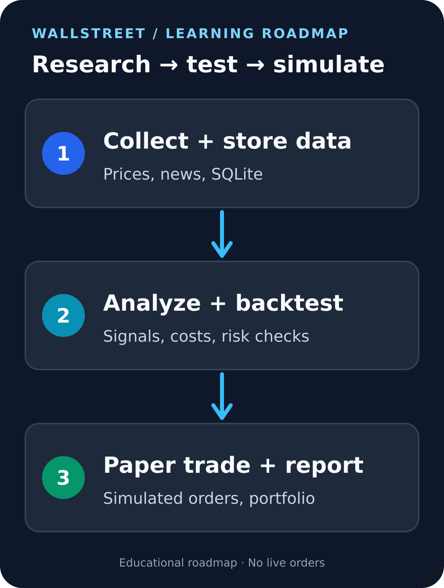

# Wallstreet

[](https://github.com/Thavarshan/wallstreet/actions/workflows/tests.yml)
[](LICENSE)

[](https://github.com/Thavarshan/wallstreet/issues)

**Learn Python by building an honest, AI-assisted stock-market research and paper-trading app, one GitHub issue at a time.**

Wallstreet is a learning project for Jerome. It is **not** a ready-made trading bot, an investment recommendation service, or a promise of passive income. The goal is to understand the data, write the Python yourself, test every decision, and eventually simulate an entire portfolio safely.

> **Current status: learning scaffold only.** No live brokerage connection, real-money order placement, or withdrawals are implemented. Paper trading comes after research, backtesting, and risk controls.

## Start here

1. Read [How to learn with this repository](docs/LEARNING_GUIDE.md).
2. Look through the [roadmap](docs/ROADMAP.md).
3. Open **[Issue #1: Set up Python and run the project](https://github.com/Thavarshan/wallstreet/issues/1)**.
4. Finish one issue, run its tests, and leave yourself notes before starting the next.

Each issue explains **why** the feature exists, **what Python concepts** you will practice, **which files to change**, **a small example**, **tests to write**, and **how to know you are done**. You are supposed to write the feature code yourself. Ask an AI assistant for explanations, examples, and code reviews—not a complete solution unless you change your mind. The [roadmap links to every lesson](docs/ROADMAP.md#issue-index).

## What you will eventually build



The diagram is also available as an [editable SVG](docs/assets/wallstreet-pipeline.svg). The PNG is used here because GitHub's mobile app does not consistently render Mermaid diagrams.

The pipeline always allows **HOLD**: the safest system often makes no trade. Models make uncertain forecasts, not guarantees.

### Advanced research (after the foundations)

The [advanced learning tracks](docs/ADVANCED_RESEARCH.md) extend Wallstreet into a market movement analyzer, a regime-aware strategy laboratory, and an AI research agent that proposes algorithm improvements. Start these only after the prerequisites in their issues:

- **[Market movement analyzer — Issues #23–27](https://github.com/Thavarshan/wallstreet/issues/23):** explain trend, volatility, abnormal volume, regime changes, sector breadth, and the effects of published news.
- **[Adaptive strategy lab — Issues #28–33](https://github.com/Thavarshan/wallstreet/issues/28):** evaluate next-session probabilities, regime-specific rules, position sizing, honest walk-forward tests, and competing paper strategies.
- **[AI-guided improvement — Issues #34–39](https://github.com/Thavarshan/wallstreet/issues/34):** produce evidence packs, let AI propose configuration or code changes on a branch, test them independently, and create pull requests for human review.

Read the [adaptive-strategy policy](docs/ADAPTIVE_STRATEGY_POLICY.md) before implementing any automated AI changes. **The agent may propose and test changes; it may not self-approve, merge, bypass risk checks, activate live trading, or withdraw money.**

## Prerequisites

- A Mac, Linux, or Windows computer with Python **3.12 or newer**.
- A text editor such as VS Code.
- Git and a GitHub account.
- Curiosity and patience. Prior Python experience is *not* required.

### First local run (macOS/Linux)

```bash
git clone https://github.com/Thavarshan/wallstreet.git
cd wallstreet
python3 -m venv .venv
source .venv/bin/activate
python -m pip install --upgrade pip
python -m pip install -e '.[dev]'
python -m wallstreet
python -m pytest
```

On Windows, activate with `.venv\Scripts\activate`. If `python` is not found, try `python3`. The package currently prints a welcome message and runs a tiny starter test; subsequent issues turn it into a real app.

## Repository layout

| Path | Purpose |
| --- | --- |
| `src/wallstreet/` | Python package you will develop |
| `tests/` | Small, repeatable automated tests |
| `docs/` | Learning guide, roadmap, glossary, architecture |
| `issues/` | Markdown copies of the planned learning issues |
| `.github/workflows/` | Continuous-integration checks, later scheduled jobs |
| `.env.example` | Placeholder names for configuration, **never actual secrets** |
| `CONTRIBUTING.md` | How to help without taking away the learning experience |
| `SECURITY.md` | How to report vulnerabilities privately |

## Our rules

1. **Paper first.** Never implement or activate real trading as part of an early learning task.
2. **Proof before prediction.** Compare any strategy with a simple buy-and-hold benchmark, including fees and bad outcomes.
3. **Show your work.** Preserve source URLs, timestamps, and reasons for decisions.
4. **Free infrastructure is a constraint, not a guarantee of free investing.** Real trades require capital and may incur fees, taxes, and exchange costs.
5. **No hidden spending.** Scheduled jobs and inference must stop at free quotas.
6. **Keep your identity private.** Never commit home addresses, account numbers, credentials, or statements.
7. **Learn in small steps.** Simple, correct code beats elaborate architecture.

## Technologies (introduced when you need them)

| Stage | Technology | Reason |
| --- | --- | --- |
| Foundations | Python, `venv`, `pytest` | Understand code and tests |
| Storage | `sqlite3` | A free database built into Python |
| Data collection | HTTP requests, RSS, official APIs | Repeatable datasets |
| Analysis | `pandas` and simple statistics | Examine price patterns |
| AI (optional) | Free inference or local baseline | Classify news; don't trust it to decide trades |
| Automation | GitHub Actions | Run tasks without your laptop on |
| Paper brokerage | Official paper-trading API | Test behavior without real money |
| Web view | Cloudflare Workers/D1 when warranted | Low-cost read-only dashboards |

## International investing and payments

Future broker research should consider international markets, legitimate UK residency and tax details, an existing verified Wise account, and a UK bank account. **Wise is a money-transfer service, not an order-execution engine.** A broker must handle securities. Stripe is not assumed to be a destination for trading proceeds. None of this justifies bypassing account checks or residency requirements.

See the later broker-readiness issue before connecting anything live.

## A note on financial risk

No strategy is risk-free. A forecast can be wrong, a stop can execute at a worse price, and a paper account can look better than real trading. Use money you can afford to lose only after separate research and authorization. This repository is educational, not financial advice.

## Community and contributing

Wallstreet is open source and welcomes bug reports, documentation improvements, constructive reviews, and Python learning questions. Please read the [contribution guide](CONTRIBUTING.md), [Code of Conduct](CODE_OF_CONDUCT.md), and [support guide](SUPPORT.md). Use the [issue templates](.github/ISSUE_TEMPLATE) to make your question or proposal easy to understand.

This remains Jerome's learning project: contributors and AI agents should help **explain and review**, not silently complete every lesson. See [AGENTS.md](AGENTS.md) for the expectations placed on coding assistants. Significant changes are recorded in the [changelog](CHANGELOG.md).

For vulnerabilities or accidental secret exposure, follow the [security policy](SECURITY.md) rather than opening a public issue.

## License

Licensed under the [MIT License](LICENSE). Copyright © 2026 Jerome Thayananthajothy.
