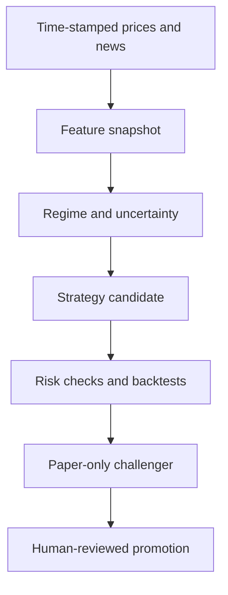

# Advanced research: understand the market before changing a strategy

These are **later lessons**, not something you need to learn before Issue #1. Once the first 22 issues are complete, Wallstreet can grow from a basic research tool into a careful experiment platform.

## Three advanced tracks

| Track | Question it answers | Deliverable |
| --- | --- | --- |
| F. Market movement analyzer | What kind of market are we in, based on data known **now**? | Reproducible feature snapshots and market-regime reports |
| G. Adaptive strategy lab | Does a given trading rule work differently in different conditions? | Historical tests and paper-only candidate strategies |
| H. AI-guided improvement | What should we investigate or change next? | Evidence-backed **proposals and pull requests**, never silent live changes |

## What is a market regime?

A *regime* is a rough label for market conditions. For example:

- `TREND_UP`: a measured upward trend.
- `TREND_DOWN`: a measured downward trend.
- `RANGE`: no sufficiently strong directional trend.
- `HIGH_VOLATILITY`: recent price changes have been unusually large.
- `LOW_VOLATILITY`: recent changes have been relatively small.
- `UNKNOWN`: not enough fresh, valid information.

These are **descriptions of data**, not predictions. A market can change direction suddenly. A strategy that works in a quiet upward market can perform badly in a violent decline.

## Conceptual workflow



### A concrete, deliberately simple example

Suppose the last 20 available daily price bars show an upward trend, and realized volatility is below a threshold chosen **before** looking at the test period.

Your analyzer may output:

```json
{
  "as_of": "2026-10-30T20:00:00Z",
  "symbol": "DEMO",
  "trend": "TREND_UP",
  "volatility": "LOW_VOLATILITY",
  "data_quality": "OK",
  "explanation": "Trend and volatility passed the predefined thresholds"
}
```

This output is an **illustration**, not an observation about a real security. The strategy can use it to decide which already-tested rule to consider. The independent risk engine can still reject any proposed order.

## What data must be preserved?

Every generated feature needs the input record IDs, their availability timestamps, a calculation version, the value, and the time at which the feature was generated. Store the original units and source. If a publication arrived after the decision date, it must be excluded from that earlier decision.

## What AI is allowed to do

AI may summarize evidence, point out surprising shifts, propose alternative parameters, write an experiment plan, or submit a reviewable pull request. It is **not** allowed to silently rewrite deployed strategy code, train on future data, bypass risk checks, trade with real money, merge its own PR, or authorize withdrawals.

We favor **configuration changes** (e.g., thresholds) over arbitrary generated code because you can test and reverse them more easily. Generated code remains possible as an advanced, human-reviewed exercise in an isolated branch.

Read [the adaptive-strategy policy](ADAPTIVE_STRATEGY_POLICY.md) and use [the experiment template](EXPERIMENT_TEMPLATE.md) before changing a strategy.
